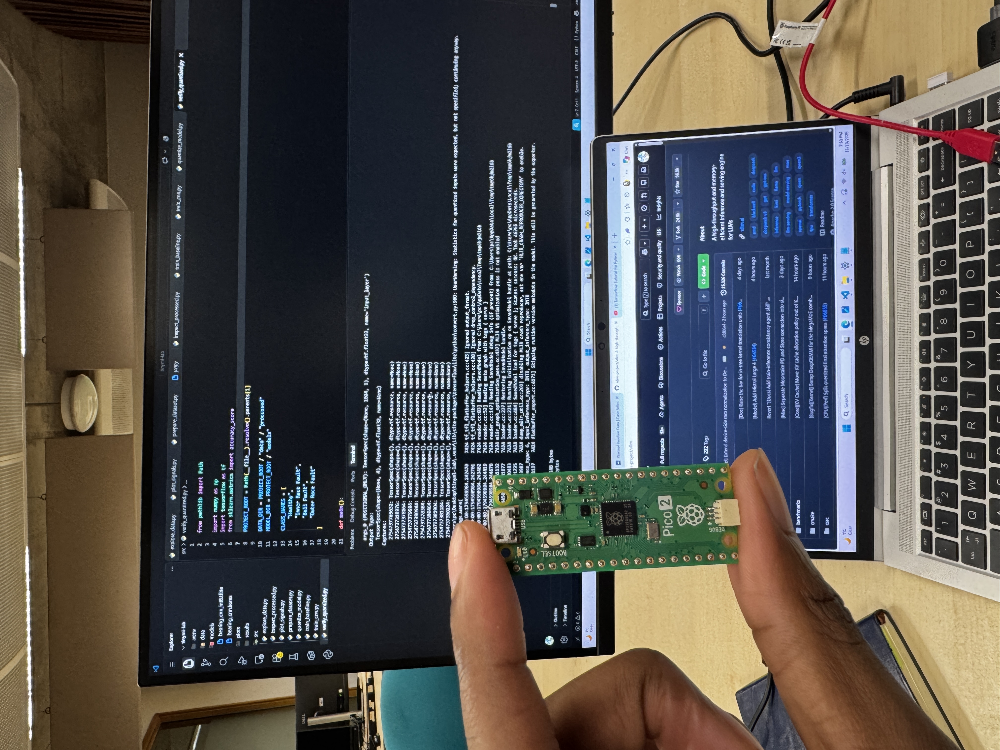

# TinyML-Based Bearing Fault Detection

## Overview

This project explores the implementation of TinyML for bearing fault detection using the Raspberry Pi Pico (RP2040) platform and TensorFlow Lite for Microcontrollers.

The aim is to investigate how machine learning can be deployed on resource-constrained embedded hardware for industrial condition monitoring and predictive maintenance.

The project combines embedded software development, machine learning integration and hardware-software interaction.




## Technologies & Tools
-
- **Hardware:** Raspberry Pi Pico (RP2040)
- **Machine Learning:** TensorFlow Lite for Microcontrollers
- **Programming Languages:** C and C++
- **Build System:** CMake
- **Embedded SDK:** Raspberry Pi Pico SDK
- **Development Environment:** Visual Studio / VS Code
- **Version Control:** Git and GitHub

## Project Structure

```text
tinyml-bearing-fault-detection/
│
├── examples/                  # Example applications
├── src/                       # Main project source code
├── sync/                      # Synchronisation components
├── tests/                     # Testing components
│
├── lib/
│   └── pico-tflmicro/         # TensorFlow Lite Micro library
│
├── CMakeLists.txt             # Main CMake configuration
├── CMakeLists.original.txt    # Original CMake configuration
├── CMakeLists_backup.txt      # Backup CMake configuration
├── CMakeLists_template.txt    # CMake template
├── pico_sdk_import.cmake      # Raspberry Pi Pico SDK integration
├── benchmark_results.txt      # Benchmark results
└── README.md
```

## Building the Project

### Prerequisites

Ensure the following are installed and configured:

- Visual Studio with C++ development tools
- CMake
- Raspberry Pi Pico SDK
- Git
- ARM GNU Toolchain (if required by the selected build configuration)

### Build Using Visual Studio CMake

The project uses the CMake executable bundled with Visual Studio 2026.

Open Command Prompt or the VS Code terminal in the project root directory.

**Step 1: Configure the project**

If the `build-arm` directory has not already been configured, run:

```cmd
"C:\Program Files\Microsoft Visual Studio\18\Community\Common7\IDE\CommonExtensions\Microsoft\CMake\CMake\bin\cmake.exe" -S . -B build-arm
```

**Step 2: Build the project**

Run:

```cmd
"C:\Program Files\Microsoft Visual Studio\18\Community\Common7\IDE\CommonExtensions\Microsoft\CMake\CMake\bin\cmake.exe" --build build-arm
```

This command builds the project using the configuration generated in `build-arm`.

**Note:** The `build-arm` directory must be configured successfully before running the build command. Any required SDK paths and toolchain settings must also be configured.

## Development Focus

The project explores several important areas of embedded AI:

- Deployment of machine learning models on microcontrollers.
- Integration of TensorFlow Lite Micro with embedded C/C++ applications.
- Memory and computational constraints of embedded devices.
- CMake-based embedded build configuration.
- Efficient machine learning inference at the edge.
- Applications of TinyML in industrial predictive maintenance.

## Future Development

Planned areas of development include:

- Vibration data acquisition and preprocessing.
- Bearing condition classification.
- Machine learning model development and evaluation.
- TensorFlow Lite Micro model deployment.
- Raspberry Pi Pico hardware integration.
- Inference performance and memory benchmarking.

## Project Status

**Under Development**

This project is an ongoing exploration of TinyML, embedded systems and edge computing.

## Author

**Joseph Imobio**


